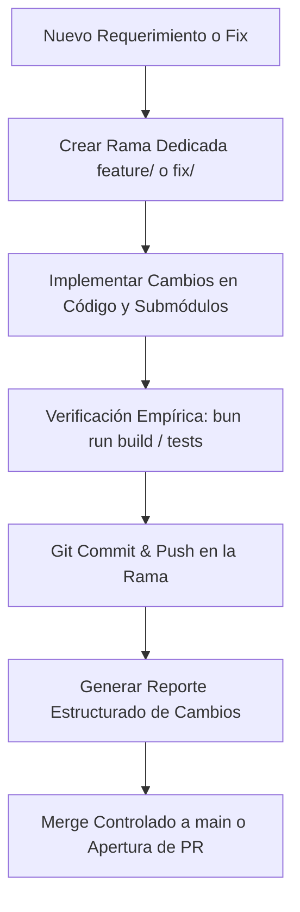

# Git Feature Branch & Change Reporting Workflow

This skill defines the standard procedure for isolated feature development, empirical verification, structured change reporting, and safe merges in this workspace.

---

## 🎯 Principios Fundamentales

1. **Aislamiento Estricto de Ramas (Nunca a `main` directamente)**:
   - Todo cambio, corrección o nuevo requerimiento **debe** desarrollarse en una rama dedicada (`feature/<nombre>`, `fix/<nombre>`, `refactor/<nombre>`).
   - `main` permanece siempre protegida y en estado desplegable y estable.
   - En proyectos con submódulos conectados a plataformas externas (como Lovable en `nexo-bridge3`):
     - **Nunca** reescribir la historia publicada (`push --force`, `rebase`, `amend` de commits ya subidos).
     - Los cambios del submódulo se confirman y suben primero a su rama remota correspondiente; luego se actualiza el puntero del submódulo en el repositorio raíz.

2. **Verificación Empírica Antes de Merge**:
   - Compilación y pruebas automáticas antes de considerar el trabajo concluido (`bun run build` / `bun test`).
   - Cero errores de compilación o empaquetado.

3. **Plantilla Estructurada de Reporte de Cambios (Change Template)**:
   - Cada entrega o propuesta de merge se documenta obligatoriamente usando la plantilla estandarizada descrita abajo.

---

## 📋 Flujo de Trabajo Paso a Paso



### Paso 1: Creación de Rama
Asegurarse de partir de un estado limpio y crear una rama de tarea:
```bash
git checkout main
git pull origin main
git checkout -b feature/<nombre-tarea>   # o fix/<nombre-tarea>
```

### Paso 2: Implementación y Cuidado de Submódulos
Si los cambios involucran un submódulo (e.g., `nexo-bridge3`):
1. Entrar al directorio del submódulo:
   ```bash
   cd nexo-bridge3
   ```
2. Trabajar en la rama correspondiente y realizar commit/push:
   ```bash
   git add .
   git commit -m "feat/fix: descripción del cambio"
   git push origin <rama>
   ```
3. Regresar a la raíz y actualizar el puntero:
   ```bash
   cd ..
   git add nexo-bridge3
   ```

### Paso 3: Verificación
Ejecutar la verificación adecuada del proyecto:
```bash
cd nexo-bridge3 && /home/dagudelo/.bun/bin/bun run build
```
Asegurar que no existan errores de tipos ni advertencias bloqueantes.

### Paso 4: Generación del Reporte (Template)
Al presentar los cambios o preparar el merge, usar siempre esta estructura:

```markdown
### 🔍 0. Diagnóstico y Contexto del Cambio
- **Objetivo / Problema**: Explicación clara de qué motivó el cambio.
- **Alcance**: Componentes, rutas o módulos afectados.

### 🚀 Cambios Implementados
- **Archivos Modificados**: Lista con enlaces (`file:///...`) y descripción de qué cambió en cada uno.
- **Decisiones Técnicas**: Lógica de negocio, fórmulas o configuraciones relevantes.

### 🧪 Verificación, Pruebas y Estado de Git
- **Resultados de Verificación**: Estado de compilación / tests (e.g. `bun run build` exitoso).
- **Rama Actual**: Nombre de la rama (`feature/...`).
- **Estado de Submódulos**: Commit hash del submódulo sincronizado.
- **Acciones Realizadas**: Commits y push ejecutados en la rama de trabajo.
- **Instrucciones / Estado de Merge**: Pasos para incorporar a `main` de manera segura.
```

### Paso 5: Merge Controlado a `main`
Una vez revisado y validado el reporte:
```bash
git checkout main
git pull origin main
git merge feature/<nombre-tarea>
git push origin main
```
