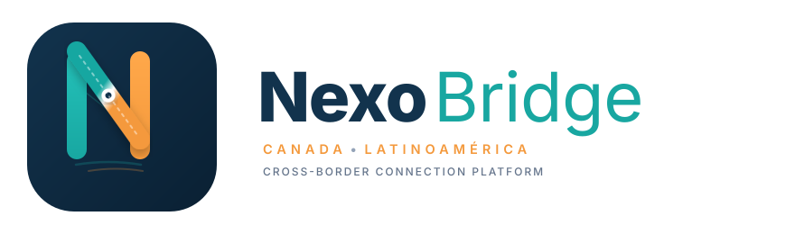
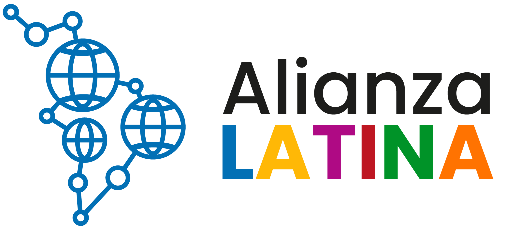

# NexoBridge

  

  <strong>Puente tecnológico de navegación comercial y asesoría binacional entre Canadá y América Latina.</strong>

  <a href="#-problemática-y-solución">Solución</a> •
  <a href="#-sponsors-y-aliados-estratégicos">Sponsors y Aliados</a> •
  <a href="#-servicios-de-asesoría-personalizada">Servicios</a> •
  <a href="#-aplicación-web">Aplicación Web</a> •
  <a href="#-equipo">Equipo</a>

---

## 📌 Problemática y Solución

* **Tema del Hackathon:** *International Trade & Business Navigation (Connecting Latino American business ideas with Canadian opportunities and Canadian Small Business with Latin America).*
* **El Problema:** Los emprendedores y pequeñas empresas se enfrentan a un camino fragmentado y abrumador para comerciar entre Canadá y América Latina debido a la alta complejidad arancelaria, normativas sanitarias y de aduanas dispersas, barreras de idioma y falta de una red de contactos especializada.
* **Nuestra Solución:** Una plataforma interactiva donde introduces una meta comercial en lenguaje natural (ej. *"Quiero importar café tostado colombiano a Toronto"*), recibes una hoja de ruta de 4 a 6 tareas priorizadas con enlaces verificados a fuentes oficiales (CBSA, CFIA, Statistics Canada, ProColombia), y te conectas con una red de aliados institucionales y asesores profesionales que pueden brindar mentoría o **realizar el 100% de los trámites por ti**.

---

## 🤝 Sponsors y Aliados Estratégicos

NexoBridge cuenta con el respaldo de aliados estratégicos de primer nivel para brindar validación comunitaria, institucional y técnica a los emprendedores:

  

### 1. [Alianza Latina](https://alianzalatina.io/)
* **Rol:** *Iniciativa Nacional & Comunidad Estratégica*
* **Sitio Web:** [alianzalatina.io](https://alianzalatina.io/)
* **Descripción:** Iniciativa colaborativa nacional que conecta a organizaciones, líderes y aliados en todo Canadá para fortalecer la visibilidad, representación e impacto colectivo de las comunidades latinas.
* **Aportes clave:**
  * Red comunitaria y colaboración de costa a costa.
  * Impulsores de *The Canadian National Latino Community Survey*.
  * Espacios de co-creación, tecnología y aceleración del impacto en IA inclusiva.

---

### 2. [Toronto Hispanic Chamber of Commerce (THCC)](https://thcc.ca/)
* **Rol:** *Aliado Institucional & Cámara Multilateral*
* **Sitio Web:** [thcc.ca](https://thcc.ca/)
* **Descripción:** Establecida en 2002 con sede en el *Toronto Board of Trade Tower*, es la principal red empresarial hispano-canadiense dedicada a promover el desarrollo económico y comercial bilateral.
* **Aportes clave:**
  * Red de contactos y eventos de networking empresarial en Canadá.
  * Foros de comercio e inversión bilateral como *Beyond Borders: Canada & Latam Business Forum*.
  * Vinculación institucional y programas de mentoría comercial.

---

### 3. [Global Trading & DS, Inc.](https://www.linkedin.com/company/global-trading-ds/people/)
* **Rol:** *Firma Consultora de Comercio Exterior & Operador Logístico*
* **Perfil:** [Global Trading & DS en LinkedIn](https://www.linkedin.com/company/global-trading-ds/people/)
* **Descripción:** Firma especializada en importación, exportación y cadena de suministro en Norteamérica y América Latina. Ofrecen el servicio integral llave en mano (*turnkey*) para gestionar toda la carga regulatoria y aduanera.
* **Aportes clave:**
  * **¡Hacen los trámites por el cliente!** Gestión directa ante CBSA, CFIA y organismos sanitarios.
  * Clasificación arancelaria (HS Codes), certificaciones de origen y cálculo de *landed costs*.
  * Coordinación de transporte multimodal y despacho aduanero.

---

### 4. [Dra. Halia Valladares Montemayor, Ph.D.](https://www.linkedin.com/in/halia-valladares-gtrading/?locale=es)
* **Rol:** *Senior Trade Advisor & Managing Partner*
* **Perfil:** [Dra. Halia Valladares en LinkedIn](https://www.linkedin.com/in/halia-valladares-gtrading/?locale=es)
* **Credenciales:** Ph.D. en Economía y Administración de Empresas, doble maestría en Logística Internacional y Comercio Internacional (Texas A&M). Ex-Decana Académica en universidades de Canadá (Okanagan College, Capilano University) y coautora de libros de texto de comercio internacional (Pearson).
* **Aportes clave:**
  * Asesoría técnica estratégica de alto nivel para proyectos de comercio bilateral.
  * Evaluación experta de viabilidad arancelaria, normativas y acuerdos comerciales (CUSMA/T-MEC, TLC).

---

## 💼 Servicios de Asesoría Personalizada

1. **Diagnóstico de Viabilidad y Estrategia 1 a 1:** Sesión técnica para evaluar aranceles, normativas sanitarias y optimización de tratados de libre comercio.
2. **Tramitación Completa "Llave en Mano":** Delegación del 100% de la gestión documental, permisos gubernamentales y trámites de importación/exportación a manos profesionales.
3. **Inserción al Ecosistema Canadiense:** Conexión con compradores, distribuidores, socios locales y cámaras de comercio a través de THCC y Alianza Latina.

---

## 🚀 Aplicación Web (NexoBridge)

El código fuente de la aplicación web completa desarrollada para el hackathon se encuentra en el submódulo [`nexo-bridge3/`](./nexo-bridge3), con soporte multi-idioma (Español, Inglés y Francés), autenticación, sistema de puntos (NexoPoints), evaluador de rutas comerciales, y modal de reserva para asesorías con los sponsors.

---

## 👥 Equipo (NexoBridge Team)

* **Alex Muñoz Angel:** Comercio, importación, exportación y distribución
* **Boris Caamaño:** Desarrollo de software
* **Yovanny Chiquiza:** Logística y visión de negocio
* **Edwin Cardoso:** Coaching y vinculación comunitaria
* **David Agudelo:** Ingeniería y arquitectura tecnológica
